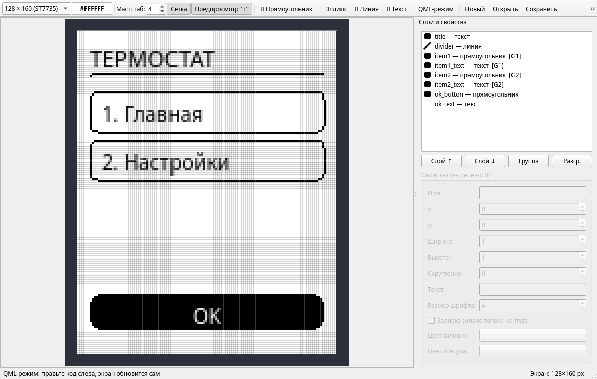
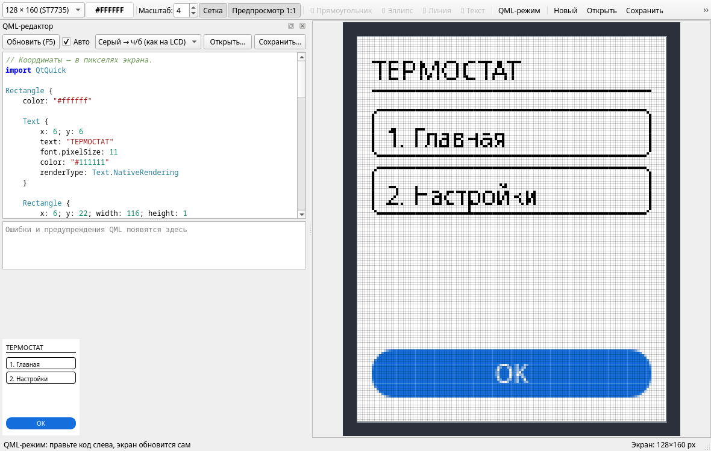

# Pixel UI Designer

Визуальный редактор интерфейсов для маленьких пиксельных дисплеев: ST7735
(128×160), SSD1306 (128×64), ILI9341 (320×240) и любых других размеров.
Позволяет без железа оценить, как интерфейс будет выглядеть на экране:
пиксели видны по отдельности, шрифт рендерится без сглаживания.



## Возможности

- холст с масштабом 1–24× и пиксельной сеткой (границы групп по 8 пикселей);
- элементы: прямоугольник (со скруглением углов), эллипс, линия, текст;
- множественное выделение: Shift+клик, рамка, Ctrl+A;
- группы (Ctrl+G / Ctrl+Shift+G) — элементы двигаются вместе;
- слои: перетаскивание строк в списке, PgUp/PgDn, порядок в контекстном меню;
- окно предпросмотра 1:1 поверх остальных окон;
- пипетка в статус-баре: координаты и цвет пикселя под курсором;
- проекты в JSON (`*.pixui.json`), экспорт PNG;
- экспорт C-заголовка с RGB565-массивом (формат `xxd -i`) с коррекцией
  контраста/насыщенности/яркости;
- QML-режим: редактор с подсветкой синтаксиса и живым рендером сцены
  прямо на пиксельный экран.

## QML-режим



Кнопка «QML-режим» открывает редактор кода: сцена перезагружается при наборе
(пауза 0,6 с) или по F5, ошибки QML выводятся в лог с координатами, кадр
обновляется на холсте и в предпросмотре 1:1. Координаты в QML — те же пиксели
дисплея; корневой `Rectangle` растягивается на весь экран.

Сглаживание Qt Quick делает мелкий текст серым, поэтому к кадру применяется
пост-обработка (выпадающий список в панели QML):

| Режим | Действие |
|---|---|
| Серый → ч/б | серые пиксели становятся чёрными/белыми, цвета сохраняются |
| Полный 1-bit | весь кадр в чёрно-белом (эмуляция монохромных дисплеев) |
| Без обработки | кадр без изменений |

В коде сцены рекомендуется `renderType: Text.NativeRendering` — нативный
рендер шрифта вместо distance-field.

## Экспорт RGB565

Кнопка «C-массив RGB565…» заменяет цепочку

```bash
ffmpeg -i icon.png -f rawvideo -pix_fmt rgb565be icon.raw
xxd -i icon.raw > image_data.h
```

Рендер выполняется прямо из макета в размер экрана, дополнительно можно
задать контраст, насыщенность и яркость (аналог фильтра `eq`) и порядок
байт: `rgb565be` или `rgb565le`. Результат — заголовок с массивом
`unsigned char` и переменной `<имя>_len`.

## Сборка

Зависимости: CMake ≥ 3.16, компилятор с C++17, Qt 6.2+ (модули Widgets,
Qml, Quick, QuickWidgets).

Arch Linux:

```bash
sudo pacman -S --needed qt6-base qt6-declarative cmake gcc
```

Debian/Ubuntu:

```bash
sudo apt install build-essential cmake qt6-base-dev qt6-declarative-dev
```

Сборка и запуск:

```bash
cmake -B build -DCMAKE_BUILD_TYPE=Release
cmake --build build -j
./build/pixeldesigner
```

## Управление

| Действие | Управление |
|---|---|
| Масштаб | спиннер в тулбаре, Ctrl+колесо мыши |
| Выделить | клик; Shift+клик — добавить/убрать; рамка на пустом месте; Ctrl+A |
| Переместить | перетаскивание, стрелки (1 px), Shift+стрелки (5 px) |
| Размер | перетаскивание уголка выделения (кроме текста) |
| Слои | перетаскивание в списке, PgUp/PgDn, контекстное меню |
| Группа | Ctrl+G, Ctrl+Shift+G |
| Дублировать | Ctrl+D |
| Удалить | Delete, Backspace |

## Формат проекта

Проект сохраняется в JSON:

```json
{
  "mode": "layout",
  "screen": { "width": 128, "height": 160, "background": "#ffffffff" },
  "elements": [
    {
      "kind": "rect",
      "name": "item1",
      "rect": [6, 30, 116, 20],
      "fill": "#ff000000",
      "stroke": "#ff000000",
      "filled": false,
      "radius": 4,
      "group": 1
    }
  ]
}
```

Для QML-режима `"mode": "qml"`, код сцены — в поле `"qml"`.

## Лицензия

[MIT](LICENSE)
